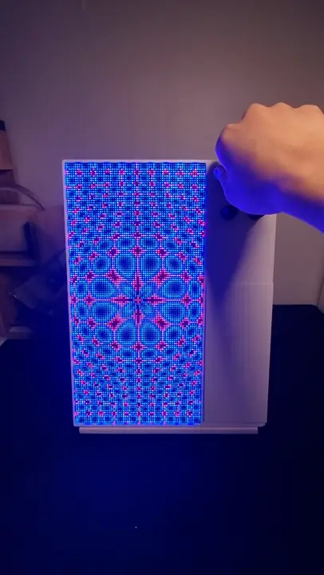
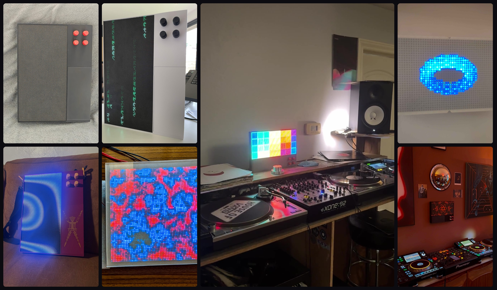
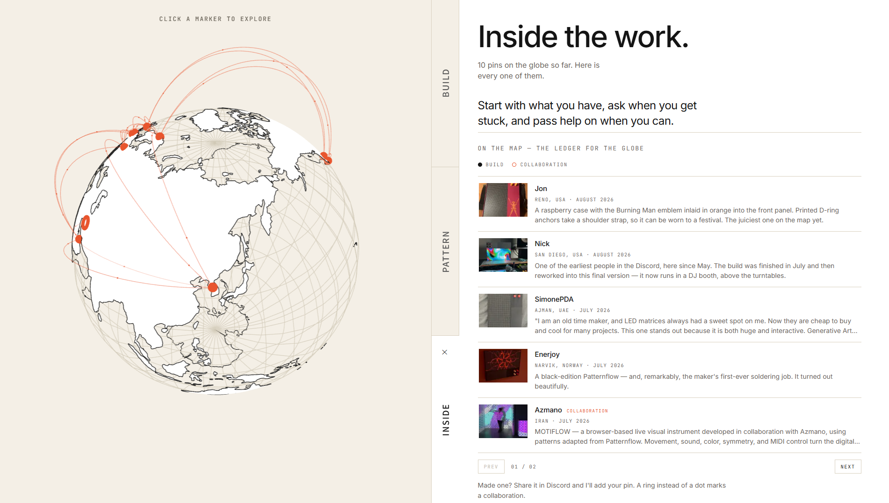
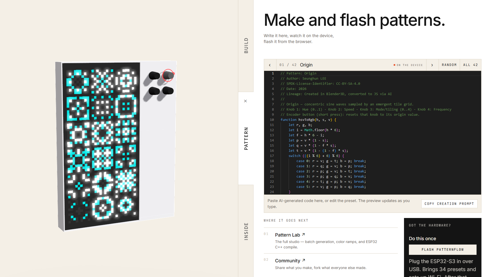
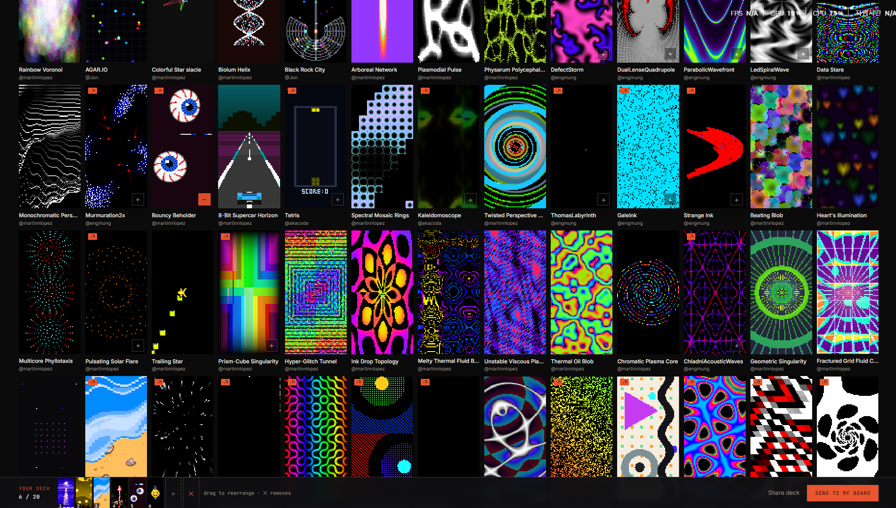
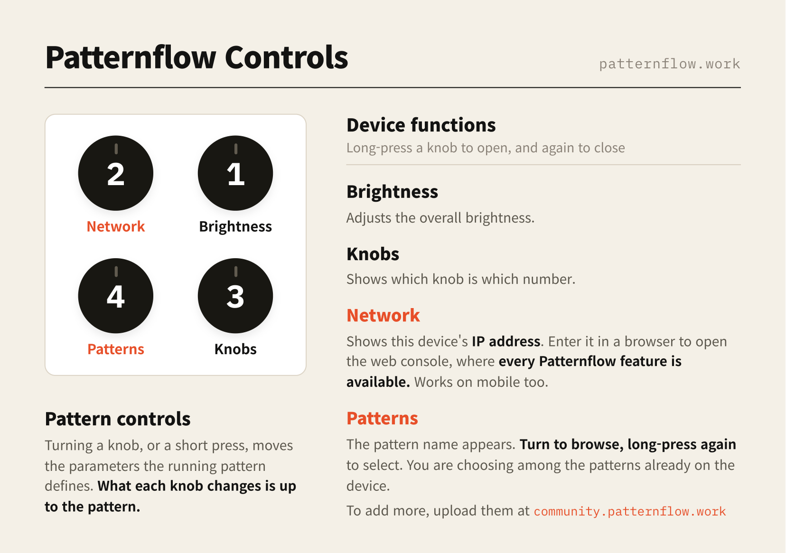
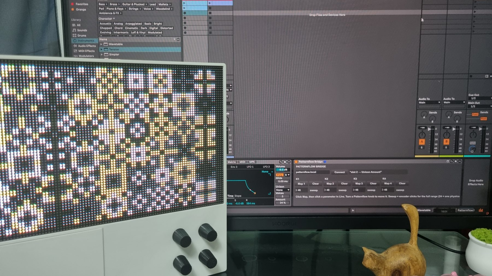
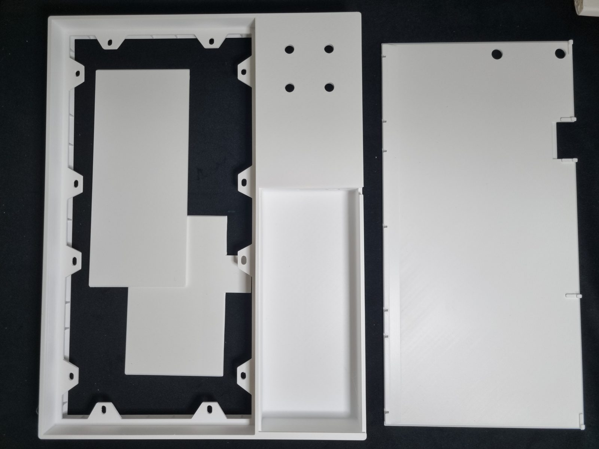

# Patternflow

**An open-source LED synthesizer.** 
Play light patterns with your fingertips.

**[Try&nbsp;one&nbsp;in&nbsp;your&nbsp;browser](https://patternflow.work/pattern)** &nbsp;·&nbsp; **[Build&nbsp;one](https://patternflow.work/guide/build)** &nbsp;·&nbsp; **[Get&nbsp;one&nbsp;assembled](https://www.crowdsupply.com/engmung/patternflow)**

  
  

  <a href="https://www.instagram.com/p/DbD2z1VSG09/">▶ the reel: <b>500k+ views</b> on Instagram</a> &nbsp;·&nbsp; <a href="https://youtu.be/1tkV8-AgdpA">▶ <b>the film</b>: the whole story, on YouTube</a>

> **Photosensitivity warning.** Patternflow displays rapidly changing light patterns that may trigger seizures in people with photosensitive epilepsy. Viewer discretion is advised. If you experience any discomfort, stop use immediately.

**Every Patternflow plays every pattern we make.** Four knobs, and the pattern answers as you turn them: 8,192 points of light, every frame computed live on the device, nothing played back. A pattern is a small file, so one made anywhere plays on all of them. And every part of the instrument is open, from the circuit board to the firmware.

Started by media artist SeungHun Lee ([@engmung](https://github.com/engmung)) in Seoul, and made by everyone who builds one, makes a pattern or sends a fix.

**Start where you are.** [The guide](https://patternflow.work/guide) shows every step on a 3D Patternflow you can turn, in English and Korean, with a **Stuck here?** link on each:

- **[Build](https://patternflow.work/guide/build):** you're soldering one from bare parts, about US$100–200 of them. Or read [BUILD_GUIDE.md](BUILD_GUIDE.md).
- **[Play](https://patternflow.work/guide/play):** yours is built. Flash it, put it on your Wi-Fi, learn the four knobs. Or read [First light](#first-light), below.
- **[Make](https://patternflow.work/guide/make):** make your own patterns, with or without a Patternflow. Or read [PATTERN_GUIDE.md](PATTERN_GUIDE.md).
- **[Audio](https://patternflow.work/guide/audio):** it plays; now add sound and MIDI with the Audio edition. Or read [AUDIO_GUIDE.md](docs/AUDIO_GUIDE.md).

## Where it began

Almost every screen around us is a playback device. It takes in content and shows it to us, and we sit in front of it and watch. Patternflow is different: touch it and it answers in that instant, and nobody plays the same thing twice.

In January 2026 I stopped by the Nam June Paik Art Center, which happened to be running an event marking twenty years since Paik's death. That is how I ended up standing in front of *Participation TV*: you speak into a microphone and the picture on the screen moves with your voice. It turned the viewer from someone watching into someone taking part. I spoke into it, and my voice became the picture.

Two months later I connected an LED matrix and a potentiometer for the first time.

I put my first pattern, *Patternflow: Origin*, on an LED matrix with four knobs and posted it online. Some people asked how to buy it; far more asked how to build it. So everything went public: schematics, firmware, 3D models, the build guide, and the whole workflow for making new patterns.

**A contemporary reinterpretation of Nam June Paik's *Participation TV* (1963). Paik let the audience change the image. Patternflow lets you make it, and give it away.**

## The community responded

  

  <i>Builds by Nath (UK), shooter (Poland), day (France), Enerjoy (Norway), SimonePDA (UAE), Nick (USA), and Jon (USA).</i>

Two of the builds above live in DJ booths. More keep arriving on the **[build map](https://patternflow.work/inside)**: a wooden case in Mexico City, a horizontal desk case in Kyiv that is now one of the remixes in this repo, a plaster shell hanging on a wall in Germany with a Raspberry Pi inside.

  

I started this alone. It hasn't worked that way for a while now. Web upload began as someone else's suggestion and proof of concept, and shipped as a main feature two days later. The pattern modules that install over Wi-Fi came from **[Simone Majocchi](https://github.com/SimonePDA)**, who designed the loader, built it and proved it on hardware before proposing it. They're core to the instrument now, and Simone went on to bring MQTT, a laser-cut case and the Performance edition. Martin Lopez has put more patterns on the Community wall than anyone, and a Patternflow went to California as thanks.

In Iran, Azmano took Patternflow's patterns, added MIDI and a microphone, and built an instrument of their own that runs in a browser, **[MOTIFLOW](https://azmano.art/portfolio-item/motiflow/)**, shown in a gallery and played at events since. Patternflow had become something people build their own instruments out of.

Underneath is an instrument still being designed, in the open, by whoever shows up. It's already moving in directions I didn't choose, and none of it was assigned. The next one is open too: a bridge for TouchDesigner or Node-RED has a place waiting in [`integrations/`](integrations/README.md), and [Contributing](#contributing) says how to start.

**Patternflow is a thing we're all making now.**

## Make it yours

Try it in the Live Editor, make it in Pattern Lab, share it on Community, and it plays on every Patternflow in the world. Then build one to play it on.

### Patterns

You don't need hardware to start. The **[Live Editor](https://patternflow.work/pattern)** is a Patternflow in your browser: the same knobs, the same detents, no account and no install. Patterns are JavaScript, and you don't have to write it yourself: click **Copy creation prompt**, paste it into your AI assistant with the look you want, paste back the code it returns, and play. The template handles the encoder mapping, brightness curve and pixel buffer; you describe the look.

  

**[Pattern Lab](https://patternflow.work/pattern-lab)** is the studio, and where a pattern reaches the hardware. Make variations through any AI chat, then shape the color ramps and retune the knob ranges. Send it to your Patternflow and it builds into a small `.pfm` module that installs over Wi-Fi in about ten seconds, with no cable, no reflash and no IDE. Graphic Export renders the same pattern as a print-size PNG for a business card or an MP4 loop for a post, in your browser, with nothing uploaded.

Then publish it to the **[Community](https://community.patternflow.work/community)**: more than a hundred patterns, from quiet waves to chaos-theory studies, all playable under the same four knobs. Collect them into a deck and send it to your board in one click. Browsing needs no account, and publishing asks only a username and password, no email. New studies go up on **[Instagram](https://www.instagram.com/patternflow.work)** almost daily; publish something that stands out and it can get featured there, or ask for a collab and I'll post yours with you. The [Make guide](https://patternflow.work/guide/make) walks the whole loop as a tutorial you do as you read, no hardware needed.

  

### The device

The **[Build Guide](BUILD_GUIDE.md)** is the official route: the v3.9 board in a 3D-printed case, about US$100–200 in parts ([BOM](BUILD_GUIDE.md#1-bill-of-materials-bom)). Order first and build later: the parts take about two weeks to arrive, and the case prints in about ten hours on a 256 mm bed. The rest is about an hour of hands-on work, half of it soldering, and every joint is a big through-hole one. Every first-timer who has built one finished it, and most came back saying the soldering was the fun part. The **[build guide in 3D](https://patternflow.work/guide/build)** is the same route on a board you can turn.

**Buy the LED panel the [BOM](BUILD_GUIDE.md#off-the-board) links.** It's verified, and the case is measured around its screw holes. Another 128 × 64 panel can match the spec line for line and still stay completely dark, because its driver chips are wrong for the board; **[Panel Compatibility](docs/panel-compatibility.md)** says how to tell before you pay.

Other routes lead to the same instrument. No printer? **[Simone Majocchi's case](hardware/case/remixes/simonepda-lasercut/README.md)** is laser-cut from acrylic or MDF, and [two more printed cases](hardware/case/remixes/README.md) sit beside the official one. No board order? The **[breadboard build](https://patternflow.work/build/breadboard)** wires the same electronics with jumper wires, and that's a real Patternflow, not a temporary prototype. Every other combination is on the **[Assembly Map](docs/assembly/README.md)**. Holding a v2.x board? [BUILD_GUIDE_v2.md](docs/legacy/BUILD_GUIDE_v2.md), with everything it needs bundled at [v2.1.0](https://github.com/engmung/Patternflow/releases/tag/v2.1.0). The current board's known issues and design notes are [BUILD_GUIDE §10](BUILD_GUIDE.md#10-known-issues--design-notes).

**When yours lights up, share it** in [Discord](https://discord.gg/Vr9QtsxeTk) or through the [Share your build](../../issues/new?template=share_build.yml) form, and I'll add your pin to the build map. The goal is simple: cover it with pins.

Rather have one arrive assembled, tested and flashed? It's on **[Crowd Supply](https://www.crowdsupply.com/engmung/patternflow)**, shipped worldwide. The campaign is past its goal and runs until 15 October 2026.

## First light

For a DevKit that has never run Patternflow, or one that needs rescuing. The same steps, with the flasher's own screens and a **Stuck here?** link on each, are the Play guide's **[Flash](https://patternflow.work/guide/play#flash)** and **[Patterns](https://patternflow.work/guide/play#patterns)** chapters; [BUILD_GUIDE §8](BUILD_GUIDE.md#8-firmware) is the same order in writing, with more on each step. Already running Patternflow, or got one assembled? Skip download mode, which erases installed patterns and saved Wi-Fi: power it from `J4` and start at step 5. Later firmware comes from the console's **Update** page over Wi-Fi, which keeps everything.

> **Power goes in through `J4`, the screw terminal, and nowhere else:** a USB cable from a 5 V power bank, cut, red to +5V and black to GND. Never power it through the DevKit's USB-C ports: they are for flashing, with the DevKit out of the board.

1. **Flash the DevKit on its own, out of the board,** from desktop Chrome or Edge. Use its **left** port, labelled `USB` (antenna up, ports toward you): the right one flashes too, but the Wi-Fi step never appears there. Use a USB-C cable that carries data; a charge-only cable is the usual reason nothing shows up.
2. **Download mode first:** hold **BOOT**, tap **RST** (EN on some DevKits), let go of BOOT. Then press **[Flash Patternflow](https://patternflow.work/guide/play#flash-5)**, pick `USB JTAG/serial debug unit` and install. It takes about two minutes and erases the flash, which a new DevKit doesn't mind.
3. **Then the Wi-Fi, which takes a second go.** The dialog usually ends without asking for it, and nothing failed: close it. Press **RST**, press **Flash Patternflow** again and pick the port, and this time it opens on Patternflow's own menu. Choose **Connect to Wi-Fi**, let the short scan finish (it lists nothing, by design), and type your network's exact name (capitals count, 2.4 GHz only) and its password.
4. **Unplug the DevKit from the computer and, with the power bank unplugged, seat it.** Its USB-C ports go toward the `USB` mark on the board, all 44 pins in. Then plug the `J4` cable into the power bank: within a second or two a red, squarish pattern comes on. That's **Origin**, and one pattern is right for now.
5. **Give it 15 seconds, then hold K2, the top-left knob,** for a second. `CONNECTED` and an address: you're on your Wi-Fi. `HOTSPOT` and a name like `patternflow-a1b2`: it found no network it knows, so it became one. Join it (password `patternflow`; the phone will say there's no internet, which is true, and it stays connected), open `http://192.168.4.1/` and add your network on the Wi-Fi page.
6. **Back on that Wi-Fi, install the Basics pack.** On the [decks page](https://community.patternflow.work/community/decks), press **Install to my board** on the Basics card: 33 patterns, no account. The first time, the board asks to format its storage: press **Format storage**, confirm, and the pack installs by itself. The board's console is at `patternflow.local`; on Android, which can't open that name, type the address K2 shows into the card's **Device address** first.

Panel stays dark? Check that the ribbon is in the panel's `IN`, not `OUT`, that red goes to +5V at both `J3` and `J4`, and that the power bank is on; for a panel other than the BOM's, see [Panel Compatibility](docs/panel-compatibility.md). Only starts after a press of RST? See [BUILD_GUIDE §10](BUILD_GUIDE.md#10-known-issues--design-notes). Then finish with [BUILD_GUIDE §9](BUILD_GUIDE.md#9-final-checks): every knob, one power cycle, the back panel, and the knobs last.

## Playing it

Every knob does two jobs. Turn it, or give it a short press, and you move the pattern that's running; what each knob does there is the pattern's own decision, so the same knob feels different on every one. Hold it down and a device function opens instead, and a second long-press closes it.

  

| Hold | Where | Opens |
| :--- | :--- | :--- |
| **K1** | top right | **Brightness** |
| **K2** | top left | **Network**: the board's address. Type it, or `patternflow.local`, into a browser for the web console, every feature the device has, from a phone too. With no Wi-Fi it shows the name of its own network instead |
| **K3** | bottom right | **Knob numbers**, each knob's number on the panel; the order isn't the one you'd guess |
| **K4** | bottom left | **Patterns**: turn to browse what's installed, stop on one to play it, long-press again to close |

### What's on the device

A new board boots into **Origin**, concentric sine waves sampled by an emergent grid. It is the one pattern compiled into the firmware, the failsafe a board can always boot into. Everything else lives on the board's storage as **`.pfm` modules**, up to 128 of them, installed over Wi-Fi with no reflash. Adding a pattern never costs a firmware update, and a firmware update never touches your patterns, your Wi-Fi or your storage.

The **Basics pack** is 33 patterns at the top of the [decks shelf](https://community.patternflow.work/community/decks), one click and no account; or drop its `.zip` on your board's Patterns page yourself. The [Live Editor](https://patternflow.work/pattern) opens with a library of its own, over forty patterns, each one loadable and remixable in the browser.

## MIDI, OSC, MQTT & audio-react

  

The default firmware is the instrument and nothing else, which leaves the most memory for your patterns. MIDI, OSC, MQTT and audio-react come in **editions**, other builds of the same firmware, installed in one click from **[the editions page](https://patternflow.work/editions)** the way patterns arrive. Switching, and switching back, keeps your patterns, Wi-Fi networks and settings. [The features page](https://patternflow.work/features) shows each feature with a reel of it, and [`docs/EDITIONS.md`](docs/EDITIONS.md) explains why it's arranged this way and how to build an edition of your own.

| | What it does | Edition | Read |
| :--- | :--- | :--- | :--- |
| **MIDI over Wi-Fi** | The panel is a MIDI port in any DAW (Ableton, Logic, Bitwig); its knobs and buttons map like any controller's (Ctrl-M in Live), and CC and Program Change play it back | Audio | [MIDI in Ableton](docs/midi-ableton.md) · [spec](docs/midi-spec.md) |
| **OSC, both ways** | Knobs, presses and pattern switches stream out to Max, TouchDesigner or Resolume; incoming OSC moves the panel exactly like a hand on the knob | Audio | [spec](docs/osc-spec.md) · [Max for Live bridge](integrations/ableton) |
| **Audio-react** | A browser tab's audio in four bands you shape, or a small microphone soldered to the DevKit; every pattern reacts with no audio code of its own | Audio | [AUDIO_GUIDE.md](docs/AUDIO_GUIDE.md) · [extension](tools/patternflow-audio-extension) |
| **MQTT** | Both ways, on the broker you already run; two panels on one broker follow each other | Performance | [spec](docs/mqtt-spec.md) |
| **HTTP** | Knob state, pattern selection, brightness, status | every firmware | [API](docs/rest-api.md) |

The panel plays its own patterns, not a video feed: nothing streams pixels to it. Your rig plays it the way a hand does, through the knobs.

**Performance**, maintained by **[Simone Majocchi](https://github.com/SimonePDA)**, is for a panel that runs a room: sequences on a timeline (cue lists and the night/wake scheduler), MQTT in every role, the weather mapped onto the knobs, and the clock.

More on MIDI, OSC, MQTT and audio-react

**MIDI, over the network.** RTP-MIDI over Wi-Fi: native on macOS and iOS, one free driver on Windows. The Pattern Lab's Director exports a show as exactly the four CC lanes the knobs answer to ([Director → MIDI](docs/director-midi.md)), so a show can play on the panel from Live's transport. Sensitivity per knob, an absolute or relative mode, and the session that reconnects itself all live on the panel's console.

**OSC.** Play Patternflow as a controller for your set, let your set play the light, or both at once. OSC is the language of Max, TouchDesigner, Resolume and Processing, and it carries more than MIDI can: pattern names, floats, a heartbeat. For Ableton Live Suite there's a ready-made Max for Live bridge in [`integrations/ableton`](integrations/ableton): click Connect, map the four knobs to any Live parameters, done.

**MQTT.** Knob turns and pattern changes publish as they happen, and messages coming the other way move the knobs and switch patterns exactly as a hand on the knob would. It puts the panel on the same bus as the rest of a home or venue, so Home Assistant, Node-RED or a lighting desk can turn its knobs and switch its patterns with nothing Patternflow-specific in the middle. Two boards pointed at the same broker follow each other, which is the short version of why it exists. Point it at a broker on the console's **MQTT** page; a pattern can be addressed by name or by slug. Publishing `1` to `<prefix>/sleep` puts the panel to sleep and `0` wakes it, with the state mirrored on `<prefix>/sleep/state`: enough for a Home Assistant switch, and the one command a panel obeys in either role. Simone's work, along with the browser-side zip unpacking that makes pattern packs install in one click.

**Audio-react.** The Chrome/Edge extension in [`tools/patternflow-audio-extension`](tools/patternflow-audio-extension) captures the current tab's audio, splits it into four bands you shape on a response graph, and sends the levels to the panel over a WebSocket. A pattern reads them as ordinary parameters. The panel can also listen for itself: a $5 PDM microphone on five thin leads runs the same analysis on the device, with no computer involved.

## Quick facts

| | |
| :--- | :--- |
| **Display** | 128 × 64 HUB75 RGB LED matrix, P2.5 (320 × 160 mm); the driver chips decide which panels work ([compatibility](docs/panel-compatibility.md)) |
| **Brain** | ESP32-S3-DevKitC-1 **N16R8** (16 MB flash, 8 MB PSRAM), plugged into sockets, never soldered · drives the panel itself, no sending card |
| **Board** | v3.9, every soldered part through-hole · KiCad source, Gerbers and schematic in [`hardware/`](hardware/README.md) |
| **Input** | 4× EC11 rotary encoders with push-switch ([controls](#playing-it)) |
| **Power** | 5 V from a USB power bank into **`J4`, the screw terminal**, its only power input · about **4 h per 10,000 mAh** at max brightness ([runtime](#power--runtime)) |
| **Size / weight** | 245 × 325 × 36 mm (9.6 × 12.8 × 1.4 in) · 933 g (2.06 lb) |
| **Firmware** | Arduino-compatible C++, patterns as modules switched at runtime, no reflash |
| **Flashing** | From the browser, once over USB with the DevKit out of the board; after that, patterns and firmware updates arrive over Wi-Fi |
| **Connectivity** | Wi-Fi, an [HTTP API](docs/rest-api.md), and a network of its own when no known one is in reach · MIDI, OSC, MQTT and audio-react in one-click [editions](#midi-osc-mqtt--audio-react) |
| **Build** | ~2 weeks for parts · ~10 h of 3D printing · ~1 h hands-on (≈30 min soldering + ≈30 min assembly, first-build friendly) · US$100–200 in parts ([BOM](BUILD_GUIDE.md#1-bill-of-materials-bom)) |
| **License** | MIT code · CC BY-SA 4.0 hardware, docs and bundled patterns · community patterns licensed by their authors ([License](#license)) |

### Power & runtime

Patternflow runs off any standard USB power bank that fits the case's compartment and can supply a couple of amps at 5 V, wired into `J4`. You don't need a wall adapter, so it stays portable.

Measured runtimes, sleep mode, and full-white patterns

In testing, a 40,000 mAh bank dropped about 13% over 2 hours at **full brightness**, which is roughly **15 hours on a full charge**:

| Power bank | Approx. runtime (max brightness) |
| :--- | :--- |
| 10,000 mAh | ~4 hours |
| 20,000 mAh | ~8 hours |
| 40,000 mAh | ~15 hours |

These were measured with a bright generative pattern at maximum brightness, which is how the device is normally used. Lowering the brightness (long-press K1) extends runtime well beyond these figures.

**Sleep mode** takes it further: the panel goes dark, the HUB75 transfer stops and the board idles, while staying on Wi-Fi so a browser (or MQTT, on the Performance edition) can wake it again. Hold K2 for the NETWORK screen, then turn K1; any knob or button wakes it. The pattern that was running comes back, as it does after a full power cut.

**A pattern that fills the screen with white is a different story.** The same 40,000 mAh bank dropped 9% in 30 minutes: about 26.6 W, or roughly 4.8 A at 5 V, which is above what a typical USB-A port is rated for and enough to make the connector warm (~5.5 hours on that bank). The firmware's total power clamp, on by default, keeps that from happening: it holds the panel to a 2.4 A budget, the high-power USB-A rating, so a white-out frame lands at roughly half brightness instead, while an ordinary bright pattern (~1.9 A) never notices. The budget is `power_budget` on the [`/api/display`](docs/rest-api.md#get-apidisplay) endpoint.

## How it's built

Patternflow is built around a standalone ESP32-S3 driving a HUB75 RGB LED matrix at low resolution, where each pixel reads as a discrete point of light with its own brightness and color. Four rotary encoders feed firmware written in Arduino-compatible C++ around a modular pattern architecture: each pattern is a self-contained module with its own setup, update and draw routines, while the shared framework handles input, LED rendering, mode transitions and color calibration. I designed the PCB myself; the enclosure is 3D-printed by default, with the community remixes in [`hardware/case/remixes/`](hardware/case/remixes/README.md) beside it. A stainless steel version is still in progress.

A local firmware build (PlatformIO, driven by `firmware/bundles/build.sh`) is only for feature development, or for a panel the stock image can't drive (a different driver profile or module layout, [Panel Compatibility](docs/panel-compatibility.md)). The setup is [`firmware/README.md`](firmware/README.md), and a new feature starts at [FEATURE_GUIDE.md](FEATURE_GUIDE.md). Patterns never need it ([Custom Patterns](firmware/CUSTOM_PATTERNS.md)). The Basics pack is built from the repo's own preset sources and zipped by [`firmware/toolchain/make_pack.py`](firmware/toolchain/make_pack.py).

## Repository & documentation

Folder by folder, and what you want to do → where to start: **[docs/REPOSITORY.md](docs/REPOSITORY.md)**. Every doc is indexed in [`docs/README.md`](docs/README.md).

The top-level folders

| Folder | Contents |
| :--- | :--- |
| `firmware/` | Arduino code for ESP32-S3, the custom pattern template, and the toolchain that builds patterns into `.pfm` modules and packs |
| `hardware/` | Enclosure files and electronics source files (case, PCB, Gerbers, schematic PDF) |
| `web/` | Next.js site (landing, the interactive guide, Live Editor, Pattern Lab, community, browser flasher & build server, journal); the breadboard build guide is a React page here |
| `docs/` | The contracts (HTTP, OSC, MIDI, MQTT, audio WebSocket, show files), how the firmware is put together (`EDITIONS.md`), the assembly map, walk-throughs, records and media |
| `tools/` | Desktop-side helpers, including the audio-react browser extension |
| `integrations/` | Host-software bridges: Ableton Live / Max for Live (OSC knob mapping) |
| `.github/` | Issue and PR templates, and the CI that runs on every pull request (web, every firmware edition, doc links, console pages) |

**Guide (interactive):** [Start here](https://patternflow.work/guide) · [Build it](https://patternflow.work/guide/build) · [Play it](https://patternflow.work/guide/play) · [Make patterns](https://patternflow.work/guide/make) · [Sound and MIDI](https://patternflow.work/guide/audio), in English and Korean 
**Build:** [Build Guide](BUILD_GUIDE.md) · [Assembly Map](docs/assembly/README.md) · [Panel Compatibility](docs/panel-compatibility.md) · [Hardware files](hardware/README.md) · [v2.x board](docs/legacy/BUILD_GUIDE_v2.md) 
**Play:** [Pattern Guide](PATTERN_GUIDE.md) · [Custom Patterns](firmware/CUSTOM_PATTERNS.md) · [Audio Guide](docs/AUDIO_GUIDE.md) · [MIDI in Ableton](docs/midi-ableton.md) 
**Extend:** [Feature Guide](FEATURE_GUIDE.md) · [Editions](docs/EDITIONS.md) · [Firmware build](firmware/README.md) · [Web architecture](web/ARCHITECTURE.md) · [HTTP API](docs/rest-api.md) · [OSC Spec](docs/osc-spec.md) · [MIDI Spec](docs/midi-spec.md) · [MQTT Spec](docs/mqtt-spec.md) · [Director → MIDI](docs/director-midi.md) 
**Project:** [Contributing](CONTRIBUTING.md) · [Support](.github/SUPPORT.md) · [Repository map](docs/REPOSITORY.md) · [Changelog](CHANGELOG.md) · [License Summary](docs/LICENSE-SUMMARY.md) · [Manifesto](docs/manifesto.md) 
**Links:** [patternflow.work](https://patternflow.work) · [Community](https://community.patternflow.work/community) · [Crowd Supply](https://www.crowdsupply.com/engmung/patternflow) · [Releases](../../releases) · [Discord](https://discord.gg/Vr9QtsxeTk) · [Instagram](https://www.instagram.com/patternflow.work)

## What's new

**Moving fast.** [v3.12.0 is out](https://github.com/engmung/Patternflow/releases/tag/v3.12.0): a board with Macronix flash keeps its patterns now, and Pattern Lab has text layers. Follow the [changelog](CHANGELOG.md) and the [journal](https://patternflow.work/journal) for what's current.

Recent releases in brief

- **[v3.12.0](https://github.com/engmung/Patternflow/releases/tag/v3.12.0)**: a board whose flash is a Macronix part mounts its pattern storage, where a Format used to not stick (fixed by @didusee). Pattern Lab has text layers, /build lets you pick the case, the community's workshop is gone, and the firmware and the site read their shared numbers from one file. Audio is re-cut on this core as v0.7.1; Performance stays at v0.4.0 until its maintainer re-cuts it.
- **[v3.11.0](https://github.com/engmung/Patternflow/releases/tag/v3.11.0)**: installed patterns run faster. The Basics pack is rebuilt and every one of its 33 patterns runs faster, 1.5 times the frames a second at the median, once the firmware is updated and the pack installed again; a pattern you go back to resumes at once instead of loading again. The console is light and reads as one thing, and the Audio edition's page and browser extension are rebuilt: the page says who has the knobs and saves only what you changed, and the extension holds the knobs through silence. Audio is re-cut on this core as v0.7.0; Performance stays at v0.4.0, on core 3.10.4, until its maintainer re-cuts it.
- **[v3.10.5](https://github.com/engmung/Patternflow/releases/tag/v3.10.5)**: every pattern 2.45 ms a frame faster, and a pattern's code moved to PSRAM, so patterns that were refused for size load and the console has more room while one is running. The panel raises its own Wi-Fi hotspot when it knows no network in reach, a panel that crashed says which pattern it was in and where, a pattern that hangs no longer takes the console down with it, and four requests that could reboot the board cannot any more.
- **[v3.10.4](https://github.com/engmung/Patternflow/releases/tag/v3.10.4)**: the panel films properly on a phone. It refreshes at exactly 300 Hz, the one rate the shutter speeds a phone actually uses (1/50, 1/60, 1/100, 1/30) all divide, so the rolling bands are gone at those; 1/120 and slow motion still band, and [the firmware README](firmware/README.md#refresh-rate-anti-flicker-for-video) says why and what to set.
- **[v3.10.3](https://github.com/engmung/Patternflow/releases/tag/v3.10.3)**: the panel's colours come out right. Bright edges had been growing purple and sky-blue fringes and greys read pink; the cause was in the display driver (which bit plane each brightness window actually lights), and part of it was 3.10.1's own dark-end fix. The planes are exactly binary now, and because the fix is in the driver every installed pattern gets it without a rebuild. Also a [Knobs page](docs/rest-api.md#get-apiknobs-and-post-apiknobs) on the device (which way each encoder counts, set from the browser) and the [features catalogue](https://patternflow.work/features). Both editions were re-cut on that core.
- **[v3.10.2](https://github.com/engmung/Patternflow/releases/tag/v3.10.2)**: a Format that did not take stops reporting success, and a storage that will not mount says why.
- **[v3.10.1](https://github.com/engmung/Patternflow/releases/tag/v3.10.1)**: fixed an upload that could reboot the board, a failed settings write that could make the next boot forget a good pattern, a mic-less Audio panel holding the knobs, and MIDI notes that would not let go.
- **[v3.10.0](https://github.com/engmung/Patternflow/releases/tag/v3.10.0)**: a heavy pattern comes on every time.
- **[v3.9.5](https://github.com/engmung/Patternflow/releases/tag/v3.9.5)**: the web console survives a slow Wi-Fi link and a heavy pattern, and thumbnails sit under the knob.
- **[v3.9.0](https://github.com/engmung/Patternflow/releases/tag/v3.9.0)**: the panel is a MIDI port over Wi-Fi, in the Audio edition.
- **[v3.8.0](https://github.com/engmung/Patternflow/releases/tag/v3.8.0)**: the firmware split into [editions](docs/EDITIONS.md), core, Audio (on-board microphone, OSC, browser and phone audio) and Performance (sequences, MQTT, weather), installable in one click and switchable without losing your patterns.
- **[v3.2.0](https://github.com/engmung/Patternflow/releases/tag/v3.2.0)**: patterns install over Wi-Fi as `.pfm` modules, no reflash.

## Contributing

Builds, documentation fixes, part sourcing tips, enclosure remixes, firmware features and host-software bridges are all welcome. **[CONTRIBUTING.md](CONTRIBUTING.md)** has one table of where each kind goes and what CI runs on it. Questions and ideas go to the **[Discord](https://discord.gg/Vr9QtsxeTk)**, and **[SUPPORT.md](.github/SUPPORT.md)** says where to ask what. Patterns don't come here: publish them from the Pattern Lab to the Community. Galleries, installations and press: [patternflow.work/contact](https://patternflow.work/contact).

## Story so far

From a visit to the Nam June Paik Art Center in January 2026 to two exhibitions in October, month by month

| When | Milestone |
| :--- | :--- |
| **Jan 2026** | *Patternflow: Origin*, my first work as a new media artist, built around 3D-printed forms and the seed of what became Patternflow · visited the Nam June Paik Art Center |
| **Mar 2026** | The Origin pattern ran on a physical LED matrix with four knobs for the first time |
| **Apr 2026** | Instagram and the Arduino subreddit responded strongly (**150,000+ views and 3,700 upvotes**), and the community asked for the files, not a product, so Patternflow went open source · first PCB fabricated *(sponsored by PCBWay)* · website live |
| **May 2026** | Reached **100 GitHub stars** · the Live Editor and Pattern Lab went live · the first collaborator joined · Crowd Supply agreement |
| **Jun 2026** | Nath in the UK finished the first Patternflow built outside the project, from the published files alone · [Crowd Supply pre-launch page](https://www.crowdsupply.com/engmung/patternflow) live · Instagram passed **1,000 followers** · first community-made pattern shared |
| **Jul 2026** | The v3.0 board, every soldered part through-hole · patterns install over Wi-Fi as modules, Simone Majocchi's design · the Pattern Community opened · featured on Creative Applications Network |
| **Aug 2026** | [Crowd Supply campaign](https://www.crowdsupply.com/engmung/patternflow) launched worldwide · firmware split into [editions](docs/EDITIONS.md) (Audio & Performance) over an unchanged core · press in Mixmag Asia, Synthtopia, AMAZONA.de and MATRIXSYNTH |
| **Sep 2026** | The Crowd Supply campaign met its funding goal · the funded units will be printed and assembled by hand in Korea, on boards from PCBWay · the first Patternflow sold as an artwork · FreeRTOS dual-core network isolation and a faster frame push |
| **Oct 2026** | The Crowd Supply campaign, open until 15 October, reached 200% of its goal · v3.11.0 and the Audio guide · *Anbu*, an exhibition by visually impaired artists at Modu Art Space near Seoul Station, with Patternflow versions of their works to play by hand · Patternflow in *USER EXPERIENCE*, a pop-up gallery in San Francisco |
| **Next** | Deliver every Crowd Supply unit at the highest quality · send Patternflow further out into the world · collaborate with more artists · earn academic recognition |
| **2028** | Grow Patternflow into a self-sustaining community and ecosystem, then move on to the next project |

Longer write-ups and the full story behind each step live on the **[journal](https://patternflow.work/journal)**: the whole process, written up week by week since April, the thinking and the emotions included, and the parts that went badly too. If you want to know why this project exists and what it costs to keep alive, start there.

### Sponsor

Patternflow's PCB fabrication and 3D-printed enclosure are sponsored by **[PCBWay](https://www.pcbway.com/)**. The first PCB came back clean and on-spec, ordering was straightforward, and the team has been genuinely responsive throughout. That support made these milestones possible.

&nbsp;&nbsp;

<i>The first Patternflow PCB, fabricated by PCBWay, and the enclosure they printed.</i>

## License

Two licenses, in two separate files. A file's SPDX header is the authority where one exists; folders are not license boundaries, and files that cannot carry a header (STL, Gerber, images) take the license the nearest README states. Full breakdown in the **[License Summary](docs/LICENSE-SUMMARY.md)**.

- Code (firmware, web, tools, integrations): **MIT** ([LICENSE-MIT](./LICENSE-MIT))
- Hardware, designs & docs: **CC BY-SA 4.0** ([LICENSE-CC-BY-SA](./LICENSE-CC-BY-SA))
- Bundled patterns (the presets shipped in the firmware and the editor): **CC BY-SA 4.0**, per-file SPDX headers.
- Anything sent *to this repository*: inbound = outbound, MIT for code and CC BY-SA 4.0 for the rest, attribution kept in the file (no CLA). See [CONTRIBUTING.md](CONTRIBUTING.md).
- Patterns published *to the Community*: **licensed by their author**, either **CC BY-SA 4.0** (default) or **CC BY 4.0**; a few older ones keep MIT or CC0, so read the pattern's own header. Both permit commercial use with credit; CC BY-SA additionally requires adaptations to stay under the same license. A fork can never be looser than what it came from, and carries a `Based on:` credit to the original author in its source.

"Patternflow" is a trademark of SeungHun Lee.

*The Patternflow series, by SeungHun Lee: LED Synthesizer (2026) · Origin (2026)*
